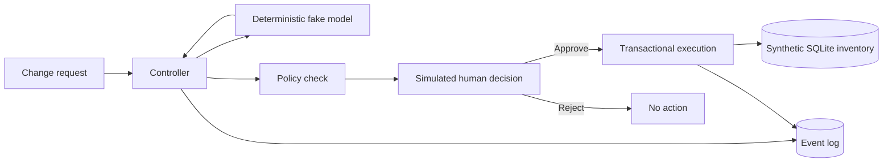

# Governed Agent Lab

[](https://github.com/kibnelbachyr/governed-agent-lab-public/actions/workflows/ci.yml)

**A reproducible reference implementation of the control plane around an AI-assisted workflow.**

[Experimental release v0.3.0](https://github.com/kibnelbachyr/governed-agent-lab-public/releases/tag/v0.3.0) · Apache-2.0. A fictional storage-retention change demonstrates separation between recommendation and execution authority. No external runtime dependencies, real provider credentials, real infrastructure, or live model calls.

## Run

Python 3.11 or 3.13 (both verified in release CI):

```sh
python -m unittest discover -s tests -v
python lab.py
```

The demo asks for explicit approval of a synthetic change, records events and deletes its temporary database when finished. Use the `Lab` interface with a persistent SQLite path to exercise restart recovery.

## Architecture and boundaries



A deterministic fake model receives a synthetic inventory snapshot. The controller checks strict, bounded UTF-8 JSON recommendation data (no arbitrary adapter callback) and typed recommendations and an illustrative 30–90 day retention rule (not legal or industry guidance). Approval binds the simulated reviewer principal to the request, recommendation digest, version, policy version and affirmative decision. Execution checks current evidence and authorization again, and transactionally records a unique action, inventory update and event.

## Evidence and continuous integration

See [local test evidence](test-results.txt) for the repeated 14-test run and [demo summary](demo-output.txt) for the scripted affirmative demo. Imported source and tests were verified against the tested Git blob identities.

The [CI workflow](.github/workflows/ci.yml) runs unit tests and affirmative/rejected demo smoke tests on Python 3.11 and 3.13 for pull requests and pushes to main. It uses no secrets or deployment steps; GitHub-hosted runner minutes are subject to account quotas. The [public release CI run](https://github.com/kibnelbachyr/governed-agent-lab-public/actions/runs/45760999145) passed on both interpreters.

## Denial audit

Expected policy or validation denials from submit, propose, decide and execute are recorded separately after the operation rolls back. The record contains only an operation name, timestamp and a verified local request ID (or null). Unknown IDs, raw payloads and exception messages are not retained by this audit path. These records persist across database reopen; the state-transition log remains separate. This does not cover unexpected exceptions or database unavailability, and audit writing is not atomic with the preceding rollback. No security-grade or tamper-resistant logging is claimed.

The original local evidence applies to v0.1. The v0.3.0 public release CI verified 19 tests and both smoke tests per interpreter.

## Offline scenario evaluation

```sh
python -m evals.run --output evaluation-report.json
```

The current [versioned fixture set](evals/cases-v2.json) defines 31 synthetic cases, retaining all 16 v1 cases. The new cases check role/session misuse, provider output, approval integrity and stale state. Each case runs three times in fresh SQLite databases; any typed assertion mismatch or unstable normalized observation digest fails CI. See the [evaluation protocol](evals/README.md) for the rubric, scope and interpretation. The public v0.3.0 release CI passed all 19 unit tests, 16 scenarios and both smoke tests on Python 3.11 and 3.13. See [validation evidence](docs/validation.md) for the scope of this result. It is a control-plane regression suite, not a held-out or independently authored LLM benchmark.

## Limitations

On current main, trusted local harness sessions simulate separate roles; they are not authenticated identities. The controller accepts bounded JSON bytes, not provider callables; this is not an OS sandbox; the SQLite event log is not tamper-proof; only expected application-level denials are captured by the denial audit. Evidence validation checks synthetic identity and revision, not factual support of free-form claims. The policy is hardcoded; local SQLite connection races are tested, not distributed execution. No live model or prompt-injection resilience has been evaluated. No cloud integration, deployment, or independently authored evaluation dataset is included. This is an experimental control-plane prototype, not a deployable security boundary.

Current development: see [ADR-001](docs/adr-001-control-plane.md) and [threat model](docs/threat-model.md). The v0.3.0 tag predates these changes. Static source checks and evidence uploads are defined in [CI](.github/workflows/ci.yml); see [verification scope](docs/static-verification.md). See [hardening acceptance and verified evidence](docs/hardening-acceptance.md). The proposed v0.4.0 is not yet released.

## License and provenance

Licensed under the [Apache License 2.0](LICENSE). This is an independently scoped, AI-assisted engineering experiment using fictional data and no employer or customer assets. The release is intended as an educational reference, not a production security product.
